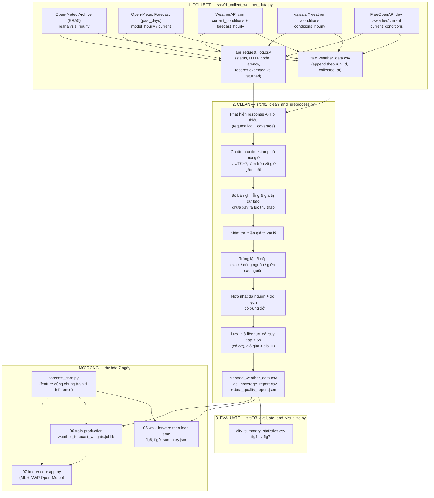
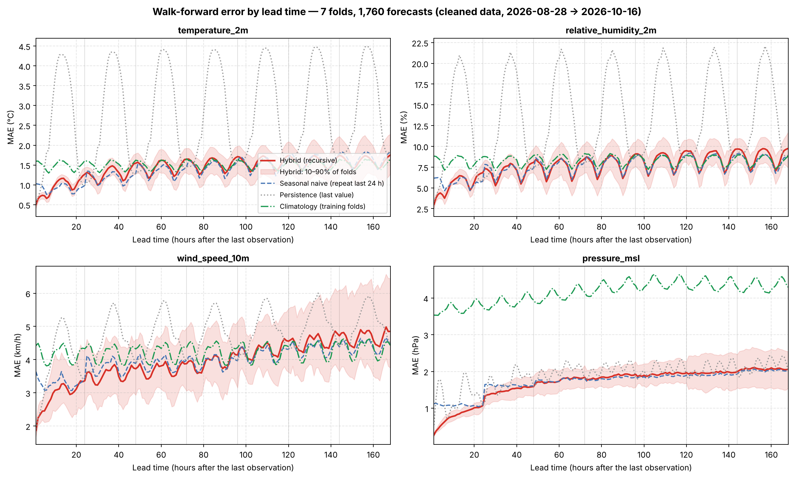
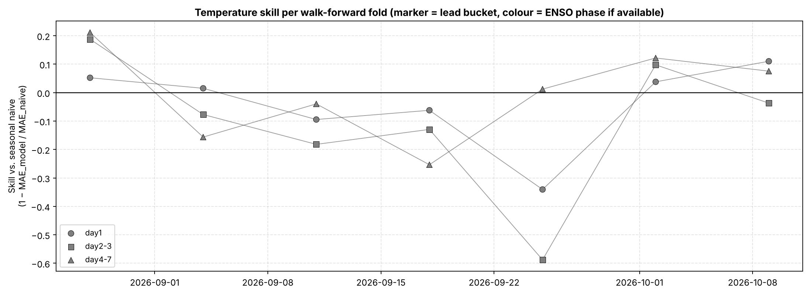

# Đề Tài 6 (Topic 6): Thu Thập Và Làm Sạch Dữ Liệu Thời Tiết Thời Gian Thực (Real-Time Weather Data Collection and Cleaning)

Repo này là toàn bộ đồ án Topic 6. Phần chính là luồng **Thu thập (`Collect`) → Làm sạch (`Clean`) → Đánh giá chất lượng (`Evaluate`)** dữ liệu thời tiết từ 4 nhà cung cấp Web API cho 20 địa điểm tại Việt Nam. Phần mở rộng (không bắt buộc theo đề) là mô hình dự báo 7 ngày, được đánh giá bằng **walk-forward theo từng lead time**.

README được viết theo đúng khung báo cáo gợi ý ở trang 9–10 của đề (Abstract → Chapter 1 → Chapter 2 → Chapter 3 → Conclusion → References), để cả nhóm đọc, nắm kiến trúc và chuẩn bị bảo vệ.

---

## Mục Lục
0. [Trang bìa (nhóm tự điền)](#0-trang-bìa-nhóm-tự-điền)
1. [Hướng dẫn chạy](#1-hướng-dẫn-chạy)
2. [Sơ đồ luồng xử lý](#2-sơ-đồ-luồng-xử-lý)
3. [Cấu trúc thư mục](#3-cấu-trúc-thư-mục)
4. [Đối chiếu yêu cầu của đề Topic 6](#4-đối-chiếu-yêu-cầu-của-đề-topic-6)
5. [Báo cáo theo khung trang 9–10](#5-báo-cáo-theo-khung-trang-910)
   - [Abstract / Introduction](#51-abstract--introduction)
   - [Chapter 1: Data Collection and Dataset Description](#52-chapter-1-data-collection-and-dataset-description)
   - [Chapter 2: Data Cleaning and Preprocessing](#53-chapter-2-data-cleaning-and-preprocessing)
   - [Chapter 3: Results and Data Quality Evaluation](#54-chapter-3-results-and-data-quality-evaluation)
   - [Chapter 4 (mở rộng): Dự báo 7 ngày và đánh giá walk-forward](#55-chapter-4-mở-rộng-dự-báo-7-ngày-và-đánh-giá-walk-forward)
   - [Conclusion, Limitations & Future Work](#56-conclusion-limitations--future-work)
   - [References](#57-references)
6. [Những thay đổi so với phiên bản trước](#6-những-thay-đổi-so-với-phiên-bản-trước)

---

## 0. Trang Bìa (nhóm tự điền)

| Mục | Nội dung |
| :-- | :-- |
| Trường / Khoa | `...` |
| Học phần | `...` |
| Đề tài | Topic 6 — Real-Time Weather Data Collection and Cleaning |
| Thành viên (Họ tên — MSSV) | `...` |

---

## 1. Hướng Dẫn Chạy

### 1.1. Cài đặt
```powershell
python -m venv .venv
.\.venv\Scripts\activate
pip install -r requirements.txt
```
Tạo file `.env` ở thư mục gốc (file này đã nằm trong `.gitignore`, **không commit**):
```text
WEATHERAPI_KEY=...
XWEATHER_CLIENT_ID=...
XWEATHER_CLIENT_SECRET=...
FREE_OPENAPI_DEV_KEY=...
```
Open-Meteo không cần key. Thiếu key nào thì request của nguồn đó được ghi là `missing_key` trong log; pipeline vẫn chạy tiếp.

> `scikit-learn` và `xgboost` được pin phiên bản trong `requirements.txt`, vì file trọng số `models/weather_forecast_weights.joblib` là pickle và chỉ load ổn định với đúng phiên bản đã train. Nếu nâng cấp thư viện thì chạy lại bước 6.

### 1.2. Mở dashboard (dùng dữ liệu và trọng số có sẵn)
Nhấp đúp `run_dashboard.bat`, hoặc:
```powershell
python -m streamlit run app.py
```

### 1.3. Chạy lại toàn bộ pipeline
```powershell
.\run_dashboard.bat --pipeline
```
hoặc chạy từng bước:
```powershell
python src/01_collect_weather_data.py            # 1. Thu thập (mode full)  -> data/raw/
python src/02_clean_and_preprocess.py            # 2. Làm sạch & hợp nhất   -> data/cleaned/
python src/03_evaluate_and_visualize.py          # 3. Thống kê + fig1 -> fig7
python src/05_walk_forward_evaluation.py         # 5. (mở rộng) Walk-forward -> models/walk_forward/, fig8, fig9
python src/06_train_production_model.py          # 6. (mở rộng) Train mô hình cho dashboard
python src/07_realtime_inference.py              # 7. (mở rộng) Dự báo 7 ngày trên CLI
```

### 1.4. Thu thập lặp lại theo thời gian (khuyến nghị cho tiêu chí "real-time")
Chế độ `realtime` chỉ gọi *current conditions* của cả 4 nguồn. Mỗi lần gọi là một `run_id` riêng và được **nối thêm (append)** vào `data/raw/raw_weather_data.csv`:
```powershell
# 72 lần, mỗi giờ 1 lần (3 ngày) — để chạy nền trên một máy luôn bật
python src/01_collect_weather_data.py --mode realtime --repeat 72 --interval-min 60
python src/02_clean_and_preprocess.py
```
Dùng `--fresh` nếu muốn ghi đè thay vì nối thêm.

### 1.5. (Tùy chọn) Dữ liệu ERA5 nhiều năm cho walk-forward
```powershell
python src/04_collect_multiyear_archive.py               # 2014 -> nay, có giới hạn tốc độ & chạy tiếp được
python src/05_walk_forward_evaluation.py --data archive  # fold 30 ngày, refit mỗi 3 fold, xếp tầng theo ENSO
python src/06_train_production_model.py --data archive
```
Tập này **không** thuộc bộ dữ liệu nộp cho Topic 6 (xem mục 4, dòng 12).

---

## 2. Sơ Đồ Luồng Xử Lý



---

## 3. Cấu Trúc Thư Mục

```text
├── app.py                               # Dashboard Streamlit (4 tab)
├── run_dashboard.bat                    # Mở dashboard; --pipeline để chạy lại toàn bộ
├── requirements.txt
├── .env                                 # API keys (không commit)
├── src/
│   ├── 01_collect_weather_data.py       # COLLECT: mode full / realtime, request log
│   ├── 02_clean_and_preprocess.py       # CLEAN: 9 bước, báo cáo chất lượng
│   ├── 03_evaluate_and_visualize.py     # EVALUATE: thống kê 20 địa điểm, fig1 -> fig7
│   ├── 04_collect_multiyear_archive.py  # (tùy chọn) ERA5 nhiều năm cho walk-forward
│   ├── 05_walk_forward_evaluation.py    # (mở rộng) đánh giá walk-forward theo lead time
│   ├── 06_train_production_model.py     # (mở rộng) train mô hình cho dashboard
│   ├── 07_realtime_inference.py         # (mở rộng) gọi API trực tiếp + dự báo 7 ngày
│   └── forecast_core.py                 # (mở rộng) feature, mô hình hybrid, dự báo cuốn chiếu
├── data/
│   ├── raw/
│   │   ├── raw_weather_data.csv         # dữ liệu thô, nối thêm theo từng lần thu thập
│   │   ├── api_request_log.csv          # 1 dòng / request (tạo từ lần thu thập đầu tiên với code mới)
│   │   ├── responses/<run_id>.json      # trích đoạn JSON gốc theo từng lần chạy (không chứa key)
│   │   └── raw_weather_responses.json   # trích đoạn JSON của lần thu thập 17/10/2026
│   ├── cleaned/
│   │   ├── cleaned_weather_data.csv     # 44,540 dòng = 20 địa điểm × 2,227 giờ
│   │   ├── multi_source_comparison.csv  # các giờ có >= 2 nguồn báo cáo
│   │   ├── api_coverage_report.csv      # bản ghi trả về / kỳ vọng theo nguồn × địa điểm
│   │   ├── city_summary_statistics.csv
│   │   └── data_quality_report.json     # chỉ số Trước / Sau của từng bước
│   └── archive/                         # (tùy chọn) ERA5 nhiều năm — không thuộc bộ dữ liệu nộp
├── models/
│   ├── weather_forecast_weights.joblib  # mô hình production (pickle)
│   ├── model_evaluation_report.json     # mô tả mô hình + kết quả walk-forward
│   └── walk_forward/                    # folds.csv, errors_by_fold_lead.csv, summary.json, ...
└── figures/                             # fig1 -> fig7 (dữ liệu), fig8 -> fig9 (mô hình)
```

---

## 4. Đối Chiếu Yêu Cầu Của Đề Topic 6

| # | Yêu cầu (đề trang 5–6) | Kết quả của nhóm | Bằng chứng |
| :-: | :-- | :-- | :-- |
| 1 | Collect weather observations through a web API, construct a time-series dataset | 4 nhà cung cấp (5 endpoint), chuỗi theo giờ liên tục 2,227 giờ × 20 địa điểm | `src/01_*`, `cleaned_weather_data.csv` |
| 2 | Suggested libraries: requests, json, pandas, datetime, matplotlib | Dùng đủ (`urllib`/`requests`, `json`, `pandas`, `datetime`, `matplotlib`) và thêm SDK `openmeteo_requests` | `requirements.txt` |
| 3 | ≥ 6 cities or locations | 20 địa điểm, gồm đủ 6 địa điểm gợi ý (HCMC, Hà Nội, Đà Nẵng, Cần Thơ, Đà Lạt, Phú Quốc) | `LOCATION_METADATA` |
| 4 | ≥ 600 observations | 49,109 dòng thô → 44,540 dòng sạch | `data_quality_report.json` |
| 5 | Time, Temperature, Humidity, Wind speed, Precipitation, Pressure | Có đủ 6 cột theo đúng tên của đề (`time`, `temperature`, `humidity`, `wind_speed`, `precipitation`, `pressure`), kèm tên chuẩn khí tượng (`temperature_2m`, …) và gió giật | `cleaned_weather_data.csv` |
| 6 | Parse JSON responses | Bóc tách JSON lồng nhau của WeatherAPI, Xweather, FreeOpenAPI và Open-Meteo `current`; lưu trích đoạn JSON gốc | `data/raw/responses/`, `raw_weather_responses.json` |
| 7 | Standardize timestamps | 4 định dạng (có/không có UTC offset) được parse **theo múi giờ** và quy về `YYYY-MM-DD HH:MM:SS` (UTC+7) | Chương 2, bước 2 |
| 8 | Detect missing API responses | **11/100** cặp nguồn × địa điểm không trả dữ liệu (WeatherAPI 5, FreeOpenAPI 6), cộng 42 ô thiếu do khác schema. Từ nay mỗi request được ghi status/HTTP code | `api_coverage_report.csv`, `fig7` |
| 9 | Detect duplicated observations | 2,780 trùng hoàn toàn + 15 trùng cùng nguồn + 779 trùng giữa các nguồn | Chương 2, bước 6 |
| 10 | Validate measurement ranges | Ngưỡng vật lý cho 6 biến (0 vi phạm), 125 giờ gió giật < gió TB đã sửa, 113 giờ các nguồn lệch nhau vượt ngưỡng được gắn cờ | Chương 2, bước 5 & 9 |
| 11 | Combine observations over time | Lưới giờ liên tục per địa điểm; chế độ `--mode realtime --repeat` để gom quan trắc qua nhiều lần gọi | Chương 2, bước 8 |
| 12 | Dataset generated by the students' own API collection code; historical datasets downloaded elsewhere are not accepted | Toàn bộ dữ liệu do code của nhóm gọi API sinh ra; không tải file có sẵn. **Lưu ý trung thực:** 44,640/49,109 dòng thô (91%) là ERA5 reanalysis lấy qua Open-Meteo Archive API. Các nguồn thời gian thực đóng góp 4,469 dòng (7.4× mức tối thiểu 600). Nên chạy thêm mục 1.4 trước khi nộp để tăng phần quan trắc thực sự gom theo thời gian | Chương 1 |

> **Câu hỏi phản biện thường gặp:** *"Đề không nhận historical dataset, sao nhóm dùng Open-Meteo Archive?"*
> Quy định nhằm cấm tải file CSV làm sẵn (Kaggle/UCI/GitHub). Nhóm tự viết code gọi API và tự làm sạch mọi dòng, nên vẫn đúng tinh thần đề. Tuy vậy phần lớn số dòng là dữ liệu lịch sử. Vì vậy nhóm (1) tách bạch nguồn bằng cột `source_api`/`record_type`, (2) giữ tập ERA5 nhiều năm của phần mở rộng **ngoài** bộ dữ liệu nộp, và (3) bổ sung chế độ thu thập real-time lặp lại theo giờ.

---

## 5. Báo Cáo Theo Khung Trang 9–10

### 5.1. Abstract / Introduction
* **Mục đích:** xây dựng quy trình tự động thu thập dữ liệu thời tiết từ nhiều Web API cho 20 địa điểm ở Việt Nam, phát hiện và xử lý các vấn đề chất lượng, rồi hợp nhất thành một chuỗi thời gian theo giờ đáng tin cậy.
* **Bài toán dữ liệu:** mỗi API trả về một định dạng thời gian khác nhau (có/không có UTC offset, lệch phút), cấu trúc trường khác nhau (FreeOpenAPI không có độ ẩm, áp suất, gió giật), có những request không trả dữ liệu, các endpoint trùng giờ với nhau, có giá trị *dự báo* lẫn trong dữ liệu *quan trắc*, và các nhà cung cấp lệch nhau có hệ thống.
* **Nguồn dữ liệu:** Open-Meteo (Archive ERA5 + Forecast), WeatherAPI.com, Vaisala Xweather, FreeOpenAPI.dev.
* **Kết quả:** 49,109 dòng thô → 44,540 dòng sạch (20 × 2,227 giờ, 17/07/2026 00:00 → 17/10/2026 18:00), 0 ô khuyết, 0 trùng lặp. Phát hiện 11 response API bị thiếu, 995 giá trị dự báo chưa xảy ra lúc thu thập, 3,574 bản ghi trùng (3 cấp) và độ lệch hệ thống giữa các nguồn. Phần mở rộng là mô hình dự báo 7 ngày, được đánh giá walk-forward theo lead time.

### 5.2. Chapter 1: Data Collection and Dataset Description
*(Code: `src/01_collect_weather_data.py`)*

#### 1. Phương pháp thu thập
Chương trình Python gửi HTTP GET tới từng API; với Open-Meteo hourly thì dùng SDK chính thức `openmeteo_requests`, có cache và retry. API key đọc từ `.env` và được che (`key=***`) trong mọi log. Mỗi lần chạy có `run_id` và `collected_at`. Mỗi request được ghi vào `api_request_log.csv` với trạng thái `ok / empty / http_error / network_error / parse_error / missing_key`, mã HTTP, độ trễ, và số bản ghi kỳ vọng so với số trả về.

Hai chế độ:
* `--mode full`: 1 lần thu thập đầy đủ (bảng dưới).
* `--mode realtime --repeat N --interval-min M`: gọi *current conditions* của cả 4 nguồn mỗi M phút, N lần; dữ liệu được nối thêm vào file thô.

#### 2. Nguồn dữ liệu và số bản ghi (lần thu thập ngày 17/10/2026)

| Nguồn (`source_api`) | Endpoint | `record_type` | Bản ghi thô |
| :-- | :-- | :-- | --: |
| Open-Meteo Archive | `archive-api.open-meteo.com/v1/archive` (93 ngày) | `reanalysis_hourly` (ERA5) | 44,640 |
| Open-Meteo Forecast | `api.open-meteo.com/v1/forecast?past_days=5&forecast_days=1` | `model_hourly` | 2,880 |
| WeatherAPI.com | `/v1/forecast.json?days=3` | `current_conditions` (15) + `forecast_hourly` (1,080) | 1,095 |
| Vaisala Xweather | `/conditions/{lat},{lon}?from=-24hours` | `conditions_hourly` | 480 |
| FreeOpenAPI.dev | `/api/v1/weather/current` | `current_conditions` | 14 |
| **Tổng** | | | **49,109** |

Lần thu thập này được chạy bằng phiên bản code đầu tiên, khi chưa có `run_id`/`record_type`/request log. Bước 2 khôi phục nhãn **chính xác** dựa vào thứ tự ghi cố định của code cũ: 20 khối archive, rồi 20 khối forecast; với WeatherAPI, dòng đầu mỗi khối là `current`. Thời điểm thu thập được xác định là 17/10/2026 18:00, tức giờ của snapshot `current` muộn nhất.

#### 3. Cấu trúc dữ liệu thô
`raw_weather_data.csv`, mỗi dòng gồm:
* **Định danh lần chạy:** `run_id`, `collected_at`
* **Thời gian:** `date` (chuỗi gốc của API), `timezone`
* **Địa điểm:** `location_id`, `city`, `region`, `requested_lat/lon`, `api_latitude/longitude`, `elevation_m`
* **Nguồn:** `source_api`, `source_family`, `record_type`, `endpoint`
* **6 biến:** `temperature_2m` (°C), `relative_humidity_2m` (%), `wind_speed_10m` (km/h), `wind_gusts_10m` (km/h), `precipitation` (mm), `pressure_msl` (hPa)

#### 4. Đặc điểm dữ liệu thô
* **4 định dạng thời gian:** `2026-10-17 11:00:00+07:00` (47,520), `2026-10-17T11:00:00+07:00` (480), `2026-10-17T17:45:00` không offset (14), `2026-10-17 11:00` không offset (1,095).
* **Response thiếu:** WeatherAPI không trả dữ liệu cho 5 địa điểm (Phu Loc - Hue, Hanoi, Phu Quoc, Ca Mau, Con Dao). FreeOpenAPI không trả cho 6 địa điểm (Vinh, Hue City, Phan Thiet, Con Dao, Pleiku, Buon Ma Thuot).
* **Khác schema:** FreeOpenAPI không có `relative_humidity_2m`, `pressure_msl`, `wind_gusts_10m` (42 ô trống).
* **Giá trị dự báo lẫn trong dữ liệu:** 995 dòng có giờ muộn hơn thời điểm thu thập (WeatherAPI 795, Open-Meteo 200).
* **Nhiễu biểu diễn Float32:** 158,173 ô (ví dụ `28.100000381469727`), do SDK giải mã FlatBuffers.

### 5.3. Chapter 2: Data Cleaning and Preprocessing
*(Code: `src/02_clean_and_preprocess.py`; số liệu: `data/cleaned/data_quality_report.json`)*

| Bước | Vấn đề | Phương pháp | Kết quả |
| :-: | :-- | :-- | :-- |
| 1 | **Response API bị thiếu** | Với lần chạy có request log: đọc `status`. Với lần chạy cũ: so số bản ghi trả về với số kỳ vọng của từng request (archive: số giờ của batch; forecast: 144; WeatherAPI: 73; Xweather: 24; FreeOpenAPI: 1) | 11/100 cặp nguồn × địa điểm thiếu → `api_coverage_report.csv`, `fig7`. Giờ đó được bù bằng các nguồn còn lại |
| 2 | **Timestamp không đồng nhất** | Chuỗi có offset (`+07:00`, `Z`) được chuyển từ đúng offset đó; chuỗi không offset được hiểu theo `timezone` mà API báo cho dòng đó; tất cả quy về `Asia/Ho_Chi_Minh` rồi làm tròn về **giờ gần nhất** (snapshot 17:45 → 18:00) | 49,109 → 0 timestamp chưa chuẩn; 26 bản ghi lệch phút được căn giờ |
| 3 | **Bản ghi rỗng** | Bỏ dòng mà cả 6 biến đều trống | 0 dòng (lần chạy này) |
| 4 | **Giá trị chưa xảy ra lúc thu thập** | Bỏ dòng có giờ > `collected_at` của chính lần chạy đó. Mốc là thời điểm thu thập, không phải lúc chạy bước làm sạch, nên chạy lại bước 2 vào hôm sau không biến dự báo thành "quan trắc" | 995 dòng |
| 5 | **Miền giá trị** | Nhiệt −10…50 °C; ẩm 0…100 %; gió 0…200 km/h; giật 0…250; mưa 0…300 mm; áp 850…1080 hPa. Ngoài ngưỡng → missing | 0 vi phạm |
| 6a | **Trùng hoàn toàn** | Cùng nhà cung cấp, địa điểm, giờ và cùng giá trị | 2,780 (endpoint Forecast của Open-Meteo trả y hệt Archive ở 6 ngày chồng nhau) |
| 6b | **Trùng cùng nguồn, cùng giờ** | Giữ bản ghi theo thứ hạng `reanalysis > conditions > current > model > forecast`, cùng hạng thì lấy lần thu thập mới nhất; lấy theo từng biến (biến nào thiếu thì lấy từ bản ghi hạng kế tiếp) | 15 (WeatherAPI `current` trùng giờ với `forecast_hourly`) |
| 6c / 7 | **Trùng giữa các nguồn → hợp nhất** | Trung bình các nguồn tại cùng (địa điểm, giờ); lưu `num_sources`, `source_api`, `record_types`, độ lệch `spread_*`; gắn `cross_source_conflict` nếu lệch nhiệt > 3 °C, ẩm > 20 % hoặc áp > 5 hPa | 779 bản ghi → 514 giờ đa nguồn; 113 giờ xung đột được gắn cờ |
| 8 | **Ghép theo thời gian** | Lưới 1 giờ liên tục cho mỗi địa điểm; chỉ nội suy theo thời gian các khoảng trống ≤ 6 giờ (cột `is_imputed`, `imputed_vars`); khoảng trống dài hơn để trống (NaN) | 20 × 2,227 giờ; 0 ô phải nội suy |
| 9 | **Nhất quán giữa các biến & làm tròn** | `wind_gusts ≥ wind_speed`; làm tròn 2 chữ số; thêm cột tên theo đề (`temperature`, `humidity`, `wind_speed`, `pressure`) | 125 giờ được sửa; 158,173 ô nhiễu Float32 được làm tròn |

Giá trị cực trị theo 1.5×IQR (nhiệt 198, gió 674, ẩm 302, mưa > 5 mm/h 479, áp 38, gió giật 472) **được giữ lại**, vì đều nằm trong ngưỡng vật lý và là thời tiết thật: mưa lớn, gió mùa, vùng núi cao.

### 5.4. Chapter 3: Results and Data Quality Evaluation
*(Code: `src/03_evaluate_and_visualize.py`)*

#### 1. So sánh trước và sau khi làm sạch

| Chỉ số | Trước | Sau |
| :-- | :-: | :-: |
| Tổng số dòng | 49,109 | **44,540** (20 × 2,227 giờ) |
| Số địa điểm | 20 | 20 |
| Response API bị thiếu (nguồn × địa điểm) | 11 / 100 | phát hiện & ghi nhận; giờ đó bù bằng nguồn khác |
| Timestamp chưa chuẩn hóa | 49,109 (4 định dạng) | 0 |
| Giá trị dự báo chưa xảy ra lúc thu thập | 995 | 0 |
| Trùng hoàn toàn | 2,780 | 0 |
| Trùng cùng nguồn, cùng giờ | 15 | 0 |
| Trùng giữa các nguồn | 779 | 0 (hợp nhất thành 514 giờ đa nguồn) |
| Ô khuyết | 42 | 0 |
| Vi phạm ngưỡng vật lý | 0 | 0 |
| Gió giật < gió trung bình | 125 | 0 |
| Giờ các nguồn lệch nhau vượt ngưỡng | — | 113 (gắn cờ, không xóa) |
| Ô nhiễu Float32 | 158,173 | 0 |

#### 2. Độ lệch hệ thống giữa các nguồn (cùng địa điểm, cùng giờ, so với Open-Meteo)

| Nguồn | Số giờ khớp | Nhiệt độ | Độ ẩm | Áp suất | Gió |
| :-- | --: | --: | --: | --: | --: |
| Xweather API | 480 | **+1.49 °C** | −4.05 % | −0.21 hPa | −0.64 km/h |
| WeatherAPI.com | 285 | −0.61 °C | +0.01 % | −0.69 hPa | +0.43 km/h |
| FreeOpenAPI.dev | 14 | +0.15 °C | — | — | 0.00 km/h |

Xweather ấm hơn Open-Meteo trung bình 1.5 °C. Dịch giờ ±1–3 giờ không làm sai khác giảm, tức đây không phải lỗi lệch múi giờ mà là lệch mức. Nguyên nhân hợp lý là khác biệt đại diện: trạm/phân tích điểm so với ô lưới reanalysis. Các địa điểm có ô lưới cao hoặc địa hình phức tạp có nhiều giờ xung đột nhất: Dien Bien Phu 26/26 giờ đa nguồn, Phu Loc - Hue (ô lưới 1,002 m) 24/25. Lấy trung bình nhiều nguồn vì vậy tạo một "bậc" nhỏ ở khoảng 26 giờ cuối chuỗi. Bộ dữ liệu giữ `num_sources` và `spread_*` để người dùng tự lọc khi cần.

#### 3. Thống kê mô tả 20 địa điểm (`city_summary_statistics.csv`)
*(17/07/2026 00:00 → 17/10/2026 18:00, 2,227 giờ/địa điểm. Cột cuối: số giờ đa nguồn / số giờ xung đột)*

| ID | Địa điểm | Vùng | Độ cao ô lưới (m) | Nhiệt TB ± SD (°C) | Min – Max (°C) | Ẩm TB (%) | Gió TB / Max (km/h) | Tổng mưa (mm) | Áp TB (hPa) | Đa nguồn / xung đột |
| :-: | :-- | :-- | :-: | :-: | :-: | :-: | :-: | --: | :-: | :-: |
| 1 | **Phu Loc - Hue** | Central | 1002 | `21.87 ± 3.16` | `15.41 – 31.01` | 84.84 | `5.47 / 17.33` | 1,089.31 | 1009.29 | 25 / 24 |
| 2 | **Da Lat - Lam Dong** | Central Highlands | 707 | `23.07 ± 2.08` | `19.39 – 30.14` | 91.44 | `7.12 / 22.38` | 903.54 | 1012.30 | 26 / 10 |
| 3 | **Nam Dinh** | North | 3 | `27.83 ± 2.68` | `20.30 – 34.90` | 82.19 | `8.18 / 28.23` | 1,118.59 | 1007.35 | 26 / 0 |
| 4 | **Ho Chi Minh City** | South | 6 | `27.68 ± 2.39` | `23.90 – 34.15` | 83.33 | `8.44 / 22.87` | 800.58 | 1009.90 | 26 / 3 |
| 5 | **Nha Trang** | South Central | 10 | `29.16 ± 2.81` | `24.66 – 37.41` | 75.77 | `6.22 / 26.81` | 471.55 | 1008.53 | 26 / 0 |
| 6 | **Da Nang** | Central | 11 | `29.48 ± 3.36` | `23.65 – 39.70` | 73.55 | `7.15 / 23.23` | 962.61 | 1007.55 | 26 / 2 |
| 7 | **Hanoi** | North | 20 | `27.94 ± 2.83` | `19.80 – 35.65` | 80.83 | `7.40 / 24.31` | 1,034.60 | 1007.50 | 25 / 0 |
| 8 | **Can Tho** | Mekong Delta | 9 | `27.39 ± 1.97` | `23.80 – 32.95` | 84.78 | `10.11 / 26.83` | 758.38 | 1010.14 | 26 / 5 |
| 9 | **Phu Quoc** | Islands | 180 | `26.53 ± 1.94` | `23.00 – 32.20` | 87.60 | `11.26 / 27.98` | 1,080.21 | 1010.49 | 25 / 1 |
| 10 | **Ha Long** | North | 7 | `28.08 ± 2.56` | `20.35 – 36.65` | 79.00 | `8.68 / 30.95` | 1,016.04 | 1007.39 | 26 / 8 |
| 11 | **Sa Pa** | North Mountain | 1545 | `18.95 ± 2.74` | `11.40 – 26.50` | 89.35 | `3.43 / 11.59` | 1,053.35 | 1012.97 | 26 / 11 |
| 12 | **Vinh** | North Central | 8 | `28.20 ± 2.81` | `21.50 – 37.25` | 79.60 | `9.37 / 38.01` | 1,293.08 | 1007.38 | 26 / 1 |
| 13 | **Hue City** | Central | 8 | `28.75 ± 3.48` | `22.45 – 39.00` | 76.94 | `7.53 / 30.22` | 874.84 | 1007.59 | 26 / 8 |
| 14 | **Phan Thiet** | South Central | 9 | `27.95 ± 2.28` | `24.20 – 35.40` | 80.54 | `14.30 / 32.94` | 620.08 | 1009.66 | 26 / 6 |
| 15 | **Vung Tau** | South | 13 | `28.42 ± 1.77` | `24.70 – 34.50` | 78.83 | `16.01 / 34.43` | 612.18 | 1009.96 | 26 / 0 |
| 16 | **Ca Mau** | Mekong Delta | 7 | `27.72 ± 1.97` | `23.90 – 32.90` | 82.93 | `10.09 / 29.34` | 858.78 | 1010.32 | 25 / 0 |
| 17 | **Con Dao** | Islands | 92 | `28.26 ± 0.88` | `25.50 – 30.80` | 75.20 | `23.19 / 44.40` | 531.37 | 1010.40 | 24 / 2 |
| 18 | **Pleiku** | Central Highlands | 761 | `22.66 ± 2.07` | `18.80 – 30.25` | 90.86 | `14.08 / 35.69` | 1,234.88 | 1011.42 | 26 / 3 |
| 19 | **Buon Ma Thuot** | Central Highlands | 462 | `25.15 ± 2.34` | `21.10 – 31.20` | 85.19 | `9.15 / 25.60` | 941.03 | 1010.67 | 26 / 3 |
| 20 | **Dien Bien Phu** | North Mountain | 482 | `25.90 ± 2.86` | `17.74 – 33.94` | 83.68 | `3.26 / 17.71` | 713.91 | 1009.59 | 26 / 26 |

#### 4. Biểu đồ (`figures/`)
* `fig1_data_quality_before_after.png`: số lỗi phát hiện (thô) so với còn lại (sạch), và các cực trị được giữ lại.
* `fig2_range_validation_boxplots.png`: phân phối 6 biến sau làm sạch.
* `fig3_temperature_timeseries.png`: nhiệt độ trung bình ngày của 8 địa điểm đại diện.
* `fig4_all_20_cities_temperature_range.png`: dải nhiệt Min–TB–Max của 20 địa điểm.
* `fig5_multivariate_and_precipitation.png`: Nhiệt–Ẩm–Áp và tổng lượng mưa.
* `fig6_multi_api_source_comparison.png`: độ lệch hệ thống giữa các nguồn, và đường nhiệt độ của từng nguồn tại TP.HCM.
* `fig7_api_coverage_heatmap.png`: % bản ghi trả về / kỳ vọng theo nguồn × địa điểm (ô `MISSING` = response bị thiếu).

### 5.5. Chapter 4 (mở rộng): Dự báo 7 ngày và đánh giá walk-forward
*(Code: `src/forecast_core.py`, `05_walk_forward_evaluation.py`, `06_train_production_model.py`, `07_realtime_inference.py`)*

Phần này không thuộc yêu cầu của Topic 6. Nó minh họa giá trị sử dụng của bộ dữ liệu sạch.

#### 1. Mô hình
* **Mục tiêu:** dự báo giá trị 1 giờ tới của 5 biến. Dự báo 7 ngày được tạo bằng cách chạy **cuốn chiếu 168 bước**, mỗi bước dùng dự báo của bước trước làm đầu vào.
* **Feature** (một hàm dùng chung cho train và inference, đã kiểm tra khớp nhau đến 1e-7):
  * tọa độ và độ cao;
  * giờ trong ngày (sin/cos); thêm ngày trong năm khi dữ liệu ≥ 1 năm;
  * lag 1, 2, 3, 6, 12, 24, 48, 72 giờ của 5 biến;
  * trung bình và độ lệch chuẩn trượt 24 giờ;
  * climatology tại giờ dự báo, và độ lệch so với climatology tại t−1 và t−24.

  `location_id` **không** được dùng làm biến số.
* **Biến mục tiêu:** độ lệch so với climatology, được fit **chỉ trên dữ liệu train**. Với dữ liệu < 1 năm: trung bình theo địa điểm × giờ trong ngày. Với ≥ 1 năm: hàm điều hòa theo ngày-trong-năm và giờ-trong-ngày.
* **Hybrid:** kết hợp Ridge, HistGradientBoosting và GRU (PyTorch) với trọng số không âm (NNLS), rồi cộng phần dư do XGBoost học. Toàn bộ siêu tham số kết hợp được chọn trên **khối validation nằm sau** trong chính tập train:
  * trọng số thành phần học trên khối 70–85%;
  * XGBoost học trên phần dư **out-of-fold** của khối 70–100%;
  * hệ số co phần dư chọn trên khối 85–100%.
* **Giảm dần về mốc neo:** sai số cuốn chiếu tích lũy theo thời gian. Vì vậy giá trị báo cáo là `neo + e^(−h/τ)·(dự báo − neo)`. Với từng biến, **mốc neo** (climatology của tập train, hoặc seasonal naive = lặp lại 24 giờ quan trắc gần nhất) và **τ** được chọn bằng cách fit một mô hình phụ trên 85% đầu của tập train và chấm điểm dự báo 168 giờ trên 15% cuối. Không dùng dữ liệu test. Vòng lặp cuốn chiếu vẫn dùng dự báo gốc; chỉ giá trị báo cáo được giảm dần.
* **Dashboard:** trộn thêm dự báo NWP của Open-Meteo, với trọng số tăng theo lead time (0.15 → tối đa 0.55). Trọng số này là **heuristic chưa kiểm định**; dashboard hiển thị riêng cả thành phần ML.

#### 2. Thiết kế đánh giá walk-forward
* Mỗi fold là một cửa sổ test 7 ngày, trượt dần; train trên **toàn bộ dữ liệu trước fold** (expanding window), refit mỗi fold.
* Trong mỗi fold, phát dự báo 168 giờ từ mọi mốc 00h và 12h, cho cả 20 địa điểm, rồi tính MAE theo **từng lead time 1…168 giờ**.
* So với 3 baseline: *persistence* (giữ giá trị cuối), *seasonal naive* (lặp lại 24 giờ gần nhất), *climatology* của tập train.
* Skill = 1 − MAE<sub>model</sub>/MAE<sub>baseline</sub>, tính cho từng fold. Khoảng tin cậy 95% bootstrap **theo fold** (fold là một khối thời gian, không phải từng giờ độc lập).
* Không cần embargo, vì mô hình dự báo cuốn chiếu 1 giờ/bước và mọi target train đều nằm trước cửa sổ test. Mô hình dự báo trực tiếp h giờ thì cần embargo ≥ h giờ.

#### 3. Kết quả (dữ liệu Topic 6, 3 tháng)
7 fold × 7 ngày (test 2026-08-28 → 2026-10-16), 1,760 lượt dự báo 168 giờ (20 địa điểm × mốc 00h/12h), GRU bật. Kết quả chi tiết: `models/walk_forward/`.

**Nhiệt độ (°C)** — MAE trung bình qua các fold:

| Thời hạn | Hybrid | Persistence | Seasonal naive | Climatology | Skill vs seasonal naive [95% CI] | Skill vs climatology [95% CI] | Tỷ lệ fold thắng naive |
| :-- | --: | --: | --: | --: | :-: | :-: | :-: |
| 1 giờ | **0.51** | 0.54 | 1.03 | 1.60 | +0.51 [+0.46, +0.56] | +0.67 [+0.60, +0.73] | 100% |
| Ngày 1 (1–24 h) | 0.94 | 2.46 | 0.92 | 1.49 | -0.04 [-0.16, +0.05] | +0.34 [+0.22, +0.44] | 57% |
| Ngày 2–3 (25–72 h) | 1.37 | 2.67 | 1.27 | 1.50 | -0.10 [-0.29, +0.05] | +0.06 [-0.13, +0.19] | 29% |
| Ngày 4–7 (73–168 h) | 1.56 | 2.87 | 1.56 | 1.52 | -0.00 [-0.12, +0.10] | -0.04 [-0.14, +0.05] | 57% |

**Các biến khác** — MAE của Hybrid / baseline tốt nhất trong 3 baseline:

| Biến | 1 giờ | Ngày 1 | Ngày 2–3 | Ngày 4–7 |
| :-- | :-: | :-: | :-: | :-: |
| Độ ẩm (%) | **3.01** / 3.32 (persistence) | **5.37** / 5.63 (seasonal naive) | **7.27** / 7.31 (seasonal naive) | 8.39 / 8.14 (seasonal naive) |
| Tốc độ gió (km/h) | **1.87** / 1.92 (persistence) | **2.91** / 3.30 (seasonal naive) | **3.64** / 3.84 (seasonal naive) | 4.36 / 4.21 (seasonal naive) |
| Lượng mưa (mm/h) | 0.43 / 0.37 (persistence) | 0.58 / 0.56 (seasonal naive) | 0.64 / 0.57 (climatology) | 0.64 / 0.56 (climatology) |
| Áp suất (hPa) | **0.27** / 0.54 (persistence) | **0.79** / 1.08 (seasonal naive) | **1.62** / 1.69 (seasonal naive) | 1.95 / 1.90 (seasonal naive) |

*In đậm = Hybrid có MAE thấp hơn cả 3 baseline (cả hai bảng).*

Mốc neo và τ (giờ) do fold cuối tự chọn: Nhiệt độ: climatology, τ = 96, Độ ẩm: seasonal naive, τ = 24, Tốc độ gió: seasonal naive, τ = 48, Lượng mưa: seasonal naive, τ = 6, Áp suất: seasonal naive, τ = 24.



**Diễn giải.**
* **Dự báo vài giờ tới:** mô hình tốt hơn rõ rệt mọi baseline. MAE nhiệt độ ở 1 giờ là 0.51 °C, so với 1.03 °C của seasonal naive; khoảng tin cậy nằm hẳn trên 0 và mô hình thắng ở 100% fold. Con số 0.389 °C trong báo cáo cũ cũng là sai số **1 giờ tới**, chỉ trên một lần chia train/test.
* **Từ ngày 1 đến ngày 7:** với nhiệt độ, mô hình **không tốt hơn** việc lặp lại 24 giờ gần nhất hoặc climatology; khoảng tin cậy của skill đều chứa 0. Độ ẩm, gió và áp suất tốt hơn baseline một chút trong ngày 1–3, rồi ngang baseline ở ngày 4–7. Lượng mưa theo giờ thua baseline ở mọi thời hạn.
* **Hệ quả:** với 3 tháng dữ liệu, phần ML hữu ích cho dự báo ngắn hạn (vài giờ). Độ tin cậy của dự báo 3–7 ngày trên dashboard chủ yếu đến từ phần trộn NWP Open-Meteo, mà trọng số trộn chưa được kiểm định.
* **Bước giảm dần (mốc neo + τ) là cần thiết:** khi chỉ neo về climatology, áp suất ở ngày 4–7 trôi tới MAE 3.57 hPa, vì climatology của tập train không theo kịp xu hướng áp suất tăng theo mùa. Cho phép chọn mốc neo seasonal naive đưa con số này về 1.95 hPa.
* **GRU:** đóng góp nhỏ. Với cùng cấu hình damping cũ (chỉ neo về climatology), bản không GRU cho MAE nhiệt độ ngày 4–7 là 1.47 °C, bản có GRU là 1.54 °C, trong khi thời gian train mỗi fold gấp khoảng 4 lần. Nhóm giữ GRU theo thiết kế ban đầu; bỏ được bằng `--no-gru`.



#### 4. Đánh giá trên nhiều năm (tùy chọn)
Với 3 tháng dữ liệu, chỉ có vài fold trong cùng một mùa và một pha ENSO, nên chưa nói được gì về độ bền của mô hình qua các năm. Script `04_collect_multiyear_archive.py` lấy ERA5 từ 2014; giai đoạn này bao gồm El Niño mạnh 2015–16, La Niña 2020–23 và El Niño 2023–24. Sau đó `05_walk_forward_evaluation.py --data archive` chạy fold 30 ngày, refit mỗi 3 fold, và xếp tầng kết quả theo mùa và theo pha ENSO. Pha ENSO lấy từ chỉ số RONI của NOAA CPC (chỉ số chính thức từ 01/02/2026), dự phòng bằng ONI; một pha El Niño/La Niña cần ≥ 5 mùa chồng nhau vượt ±0.5 °C.

Lưu ý: walk-forward trên ERA5 đo khả năng "dự báo ERA5" chứ không phải dự báo trạm. Muốn kiểm định cả phần trộn NWP thì cần dự báo NWP lưu trữ tại đúng thời điểm phát dự báo.

### 5.6. Conclusion, Limitations & Future Work
**Kết luận.** Quy trình 9 bước biến 49,109 bản ghi thô từ 4 nhà cung cấp thành 44,540 giờ sạch, liên tục, 0 khuyết, 0 trùng. Mọi quyết định đều truy vết được qua cột nguồn, cờ xung đột, cờ nội suy và báo cáo chất lượng. Ngoài các lỗi định dạng và trùng lặp, quy trình phát hiện ra hai vấn đề mà phiên bản đầu bỏ sót: **11 response API bị thiếu**, và **giá trị dự báo lẫn vào dữ liệu quan trắc** nếu lấy mốc cắt theo lúc làm sạch thay vì lúc thu thập.

**Hạn chế.**
* Phần lớn số dòng là ERA5 reanalysis, không phải quan trắc trạm; phần real-time trong lần thu thập hiện có chỉ phủ khoảng 26 giờ cuối.
* Các nguồn lệch nhau có hệ thống (Xweather +1.5 °C), nên trung bình đa nguồn tạo bậc nhỏ ở cuối chuỗi.
* WeatherAPI `forecast.json` cho các giờ đã qua trong ngày vẫn là giá trị mô hình (`forecast_hourly`), không phải quan trắc.
* Mô hình dự báo chỉ được đánh giá trên 3 tháng dữ liệu.

**Hướng phát triển.**
* Chạy `--mode realtime` theo giờ trong nhiều ngày để có chuỗi quan trắc thật.
* Hiệu chỉnh độ lệch từng nguồn (bias correction) trước khi hợp nhất, thay cho trung bình đơn giản.
* Walk-forward trên ERA5 nhiều năm.
* Kiểm định trọng số trộn NWP bằng dự báo lưu trữ.
* Mô hình riêng cho mưa (hurdle / Tweedie), vì mưa theo giờ thưa và lệch phải.

### 5.7. References
**API & tài liệu dữ liệu**
1. Open-Meteo — Historical Weather API: https://open-meteo.com/en/docs/historical-weather-api
2. Open-Meteo — Weather Forecast API: https://open-meteo.com/en/docs
3. Zippenfenig, P. (2024). *Open-Meteo.com Weather API* (v1.4.0) [Computer software]. Zenodo. https://doi.org/10.5281/zenodo.14582479
4. Hersbach, H., Bell, B., Berrisford, P., et al. (2020). The ERA5 global reanalysis. *Quarterly Journal of the Royal Meteorological Society, 146*(730), 1999–2049. https://doi.org/10.1002/qj.3803
5. WeatherAPI.com — API documentation: https://www.weatherapi.com/docs/
6. Vaisala Xweather — Conditions endpoint: https://www.xweather.com/docs/weather-api/endpoints/conditions
7. FreeOpenAPI.dev: https://www.freeopenapi.dev/

**ENSO**

8. NOAA Climate Prediction Center — Relative Oceanic Niño Index (RONI): https://www.cpc.ncep.noaa.gov/products/analysis_monitoring/enso/roni/ ; data: https://www.cpc.ncep.noaa.gov/data/indices/RONI.ascii.txt
9. National Weather Service (2026). *Public Information Statement 26-05: CPC to use the Relative Oceanic Niño Index*. https://www.weather.gov/media/notification/pdf_2026/pns26-05_Relative_ONI.pdf

**Phương pháp đánh giá dự báo**

10. Tashman, L. J. (2000). Out-of-sample tests of forecasting accuracy: an analysis and review. *International Journal of Forecasting, 16*(4), 437–450. https://doi.org/10.1016/S0169-2070(00)00065-0

**Thư viện:** `pandas`, `numpy`, `matplotlib`, `requests`/`urllib`, `openmeteo-requests`, `scikit-learn`, `xgboost`, `scipy`, `torch`, `streamlit`.

---

## 6. Những Thay Đổi So Với Phiên Bản Trước

| Hạng mục | Trước | Sau |
| :-- | :-- | :-- |
| Response API bị thiếu | Lỗi request chỉ được `print`; 11 cặp nguồn × địa điểm không có dữ liệu mà không bị phát hiện | Request log + bảng coverage + `fig7` |
| Nhãn nguồn | Archive và Forecast đều là "Open-Meteo SDK"; không phân biệt quan trắc / dự báo | `source_api`, `source_family`, `record_type`, `run_id`, `collected_at` |
| Timestamp | Xóa `T` và `+07:00` bằng regex, làm tròn xuống (17:45 → 17:00) | Parse theo múi giờ, làm tròn về giờ gần nhất (17:45 → 18:00) |
| Mốc "chưa xảy ra" | `now()` lúc chạy bước làm sạch | Thời điểm thu thập của từng lần chạy |
| Trùng lặp | Một mức | 3 mức, có quy tắc ưu tiên theo loại bản ghi |
| Hợp nhất đa nguồn | Trung bình, không kiểm tra | Trung bình + độ lệch + cờ xung đột + bảng độ lệch hệ thống từng nguồn |
| Nội suy | Nội suy, ffill/bfill không giới hạn, không đánh dấu | Chỉ gap ≤ 6 giờ, có cờ `is_imputed` |
| Thu thập theo thời gian | Một lần duy nhất | `--mode realtime --repeat` nối thêm theo `run_id` |
| Đánh giá mô hình | Chia cố định 70/15/15; MAE 0.389 °C là sai số **1 giờ tới** nhưng được trình bày như kết quả dự báo 7 ngày | Walk-forward, MAE theo lead time 1–168 giờ, so với 3 baseline, CI theo fold |
| Rò rỉ dữ liệu khi train | XGBoost học phần dư in-sample; trọng số kết hợp cố định 0.15/0.10/0.75/0.5 | Phần dư out-of-fold; trọng số NNLS, hệ số co, mốc neo và τ đều chọn trên khối validation trong tập train |
| Train/serve skew | Train trên ERA5, inference trên trung bình nhiều nguồn; `std` khác `ddof` giữa train và inference; `location_id` là biến số | Một hàm feature dùng chung; inference dùng lịch sử Open-Meteo; bỏ `location_id` |
| Housekeeping | Hai script `04_`; thiếu `pyarrow`; link `file:///C:/...` hỏng; WeatherAPI gọi qua `http://` | Đánh số 01–07; pin phiên bản; https; README theo khung báo cáo |
