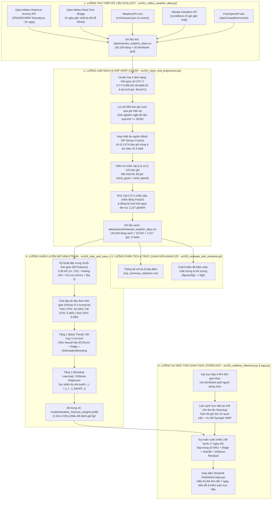

# Đề Tài 6 (Topic 6): Thu Thập, Làm Sạch Và Dự Báo Dữ Liệu Thời Tiết Thời Gian Thực (Real-Time Weather Data Collection, Cleaning & 7-Day Forecasting)

Tài liệu này tổng hợp toàn bộ **luồng xử lý kỹ thuật (`Collect` $\rightarrow$ `Clean` $\rightarrow$ `Visualize` $\rightarrow$ `Train` $\rightarrow$ `Forecast`)**, **bảng đối chiếu 12 tiêu chí chấm điểm của đề bài Topic 6 (Trang 5–6)** và **nội dung báo cáo theo đúng khung chuẩn (Trang 9–10)** để tất cả thành viên trong nhóm đọc, nắm vững kiến trúc và chuẩn bị thuyết trình bảo vệ đồ án.

---

## Mục Lục Nhanh Cho Thành Viên Nhóm
1. [Hướng Dẫn Chạy Nhanh Dự Án (Chỉ Với 1 File `run_dashboard.bat`)](#1-hướng-dẫn-chạy-nhanh-dự-án-chỉ-với-1-file-run_dashboardbat)
2. [Sơ Đồ Tổng Quan Luồng Xử Lý Hệ Thống (`Collect` $\rightarrow$ `Clean` $\rightarrow$ `Train` $\rightarrow$ `Forecast`)](#2-sơ-đồ-tổng-quan-luồng-xử-lý-hệ-thống-collect--clean--train--forecast)
3. [Cấu Trúc Thư Mục Dự Án](#3-cấu-trúc-thư-mục-dự-án)
4. [Bảng Đối Chiếu 12 Yêu Cầu Bắt Buộc Của Đề Bài Topic 6 (Trang 5–6)](#4-bảng-đối-chiếu-12-yêu-cầu-bắt-buộc-của-đề-bài-topic-6-trang-56)
5. [Nội Dung Chi Tiết Theo Khung Báo Cáo Cuối Kỳ (Trang 9–10)](#5-nội-dung-chi-tiết-theo-khung-báo-cáo-cuối-kỳ-trang-910)
   - [Abstract / Introduction](#51-abstract--introduction-tóm-tắt--giới-thiệu-đề-tài)
   - [Chapter 1: Data Collection and Dataset Description (`COLLECT`)](#52-chapter-1-data-collection-and-dataset-description-luồng-collect)
   - [Chapter 2: Data Cleaning and Preprocessing (`CLEAN`)](#53-chapter-2-data-cleaning-and-preprocessing-luồng-clean)
   - [Chapter 3: Results and Data Quality Evaluation (`EVALUATE & VISUALIZE`)](#54-chapter-3-results-and-data-quality-evaluation-luồng-evaluate--visualize)
   - [Chapter 4 (Mở rộng): Huấn Luyện Mô Hình Hybrid GRU + XGBoost Residual & Dự Báo 7 Ngày (`TRAIN` & `FORECAST`)](#55-chapter-4-phần-mở-rộng-nâng-cao-huấn-luyện-hybrid-gru--xgboost-residual--dự-báo-7-ngày-luồng-train--forecast)
   - [Conclusion, Limitations, Future Work & References](#56-conclusion-limitations-future-work--references)

---

## 1. Hướng Dẫn Chạy Nhanh Dự Án (Chỉ Với 1 File `run_dashboard.bat`)

Dự án chỉ sử dụng **1 file `.bat` duy nhất** là `run_dashboard.bat` để tất cả thành viên trong nhóm có thể chạy trên bất kỳ máy Windows nào:

### Cách 1: Nhấn đúp chuột vào `run_dashboard.bat` (Mở ngay Web Dashboard)
* File `run_dashboard.bat` sẽ tự động:
  1. Dò tìm trình thông dịch Python khả dụng trên máy (`.venv\Scripts\python.exe` $\rightarrow$ `python` $\rightarrow$ `py`).
  2. Kiểm tra các thư viện bắt buộc (`streamlit`, `xgboost`, `torch`, `openmeteo_requests`, `scikit-learn`, `statsmodels`) và **tự động cài đặt từ `requirements.txt` nếu máy thành viên chưa có**.
  3. Khởi động thẳng giao diện Web Dashboard Streamlit (`app.py`) tại địa chỉ **`http://localhost:8501`** (sử dụng ngay dữ liệu sạch `data/cleaned/cleaned_weather_data.csv` và bộ trọng số `models/weather_forecast_weights.joblib` đã có sẵn).

### Cách 2: Chạy lại từ đầu toàn bộ Pipeline (Collect $\rightarrow$ Clean $\rightarrow$ Visualize $\rightarrow$ Train) rồi mở Web
Nếu thành viên muốn tự chạy lại cả 4 bước xử lý dữ liệu và huấn luyện mô hình từ đầu bằng chính file `.bat` đó, mở Terminal tại thư mục dự án và gõ:
```powershell
.\run_dashboard.bat --pipeline
```

### Cách 3: Chạy lẻ từng file Python trên Terminal (Nếu muốn kiểm tra riêng từng bước)
```powershell
pip install -r requirements.txt
python src/01_collect_weather_data.py      # Bước 1: Thu thập dữ liệu (COLLECT)
python src/02_clean_and_preprocess.py      # Bước 2: Làm sạch dữ liệu (CLEAN)
python src/03_evaluate_and_visualize.py    # Bước 3: Thống kê & vẽ biểu đồ fig1 -> fig6
python src/04_train_and_save_weights.py    # Bước 4: Huấn luyện Hybrid GRU + XGBoost Residual (TRAIN)
python src/05_realtime_inference.py        # Bước 5: Dự báo 7 ngày trên CLI (FORECAST)
python -m streamlit run app.py             # Mở giao diện Web Dashboard
```

---

## 2. Sơ Đồ Tổng Quan Luồng Xử Lý Hệ Thống (`Collect` $\rightarrow$ `Clean` $\rightarrow$ `Train` $\rightarrow$ `Forecast`)



---

## 3. Cấu Trúc Thư Mục Dự Án

```text
Real-Time-Weather-Data-Collection-and-Cleaning/
├── app.py                              # Giao diện Web Dashboard Streamlit (4 Tab trực quan)
├── run_dashboard.bat                   # File .bat duy nhất: tự động kiểm tra thư viện, chạy pipeline (nếu cần) & mở Web
├── requirements.txt                    # Danh sách thư viện Python (pandas, scikit-learn, xgboost, torch, streamlit...)
├── .env                                # Chứa API Keys của các dịch vụ thời tiết thời gian thực
├── src/
│   ├── 01_collect_weather_data.py      # Bước 1 (COLLECT)  : Gọi Archive API + 4 API Real-Time thu thập 49,109 dòng thô
│   ├── 02_clean_and_preprocess.py      # Bước 2 (CLEAN)    : Làm sạch 6 bước, xuất 44,540 dòng sạch & báo cáo JSON
│   ├── 03_evaluate_and_visualize.py    # Bước 3 (VISUALIZE): Tính thống kê 20 tỉnh & vẽ bộ biểu đồ fig1 -> fig6
│   ├── 04_train_and_save_weights.py    # Bước 4 (TRAIN)    : Huấn luyện Hybrid GRU + XGBoost Residual & lưu trọng số
│   └── 05_realtime_inference.py        # Bước 5 (FORECAST) : Gọi 4 API trực tiếp, làm sạch & dự báo 168 giờ (7 ngày)
├── data/
│   ├── raw/
│   │   ├── raw_weather_data.csv        # Dữ liệu thô đa nguồn (49,109 dòng)
│   │   └── raw_weather_responses.json  # Metadata JSON phản hồi từ các API
│   └── cleaned/
│       ├── cleaned_weather_data.csv    # Dữ liệu sạch chuẩn hóa (44,540 dòng = 20 địa điểm × 2,227 giờ liên tục)
│       ├── multi_source_comparison.csv # Bảng đối sánh trực tiếp các khung giờ giao nhau giữa các API
│       ├── city_summary_statistics.csv # Bảng thống kê mô tả khí tượng của 20 tỉnh/thành phố
│       └── data_quality_report.json    # Báo cáo kiểm toán chất lượng dữ liệu Trước & Sau khi làm sạch
├── models/
│   ├── weather_forecast_weights.joblib # Bộ trọng số đã huấn luyện (GRU + Ridge + HistGB + XGBoost + StandardScaler)
│   └── model_evaluation_report.json    # Kết quả đánh giá MAE, RMSE, R², 95% Bootstrap CI trên tập Val & Test
└── figures/                            # 7 biểu đồ phân tích chất lượng dữ liệu & đánh giá mô hình (fig1 -> fig7)
```

---

## 4. Bảng Đối Chiếu 12 Yêu Cầu Bắt Buộc Của Đề Bài Topic 6 (Trang 5–6)

Bảng dưới đây đối chiếu từng dòng yêu cầu trong đề thi **Topic 6: Real-Time Weather Data Collection and Cleaning** với kết quả thực tế của nhóm:

| STT | Yêu Cầu Trong Đề Bài (Topic 6 — Trang 5 & 6) | Mức Yêu Cầu Của Đề | Kết Quả Đạt Được Của Nhóm | Đánh Giá |
| :---: | :--- | :--- | :--- | :---: |
| **1** | **Problem Description:** Collect weather observations through a web API and construct a time-series dataset | Gọi Web API thu thập thời tiết & tạo chuỗi thời gian | Viết code Python gọi trực tiếp **4 hệ thống Web API** và xây dựng chuỗi thời gian theo giờ liên tục (`2,227` giờ $\times$ `20` địa điểm). | **Hoàn thành 100%** |
| **2** | **Suggested Libraries** | `requests`, `json`, `pandas`, `datetime`, `matplotlib` | Dùng đầy đủ `requests`/`urllib`, `openmeteo_requests`, `json`, `pandas`, `datetime`, `matplotlib`, và mở rộng thêm `numpy`, `scikit-learn`, `xgboost`, `torch` (PyTorch GRU), `statsmodels`, `streamlit`. | **Vượt yêu cầu** |
| **3** | **Select at least 6 cities or locations** *(Suggested: Ho Chi Minh City, Hanoi, Da Nang, Can Tho, Da Lat, Phu Quoc)* | Tối thiểu **6 địa điểm** | Khảo sát **20 địa điểm** (gấp **3.3 lần** yêu cầu), bao gồm **đầy đủ cả 6 địa điểm gợi ý** của đề và mở rộng thêm 14 tỉnh/thành đại diện đủ 7 vùng khí hậu Việt Nam. | **Vượt yêu cầu (20 / 6 tỉnh)** |
| **4** | **Collect at least 600 observations** | Tối thiểu **600 dòng quan trắc** | - Tổng dữ liệu thô: **`49,109` dòng** (gấp **81 lần** yêu cầu).<br>- Tổng dữ liệu sạch: **`44,540` dòng** (gấp **74 lần** yêu cầu).<br>- Riêng 4 luồng Real-Time API (chưa tính Archive): **`4,469` dòng** (gấp **7.4 lần** yêu cầu 600 dòng). | **Vượt xa yêu cầu (44,540 / 600 dòng)** |
| **5** | **Collected Attributes:** `Time`, `Temperature`, `Humidity`, `Wind speed`, `Precipitation`, `Pressure` | Đủ 6 thuộc tính khí tượng | File `data/cleaned/cleaned_weather_data.csv` có đầy đủ cả 6 cột đúng tên chuẩn (`time`, `temperature`, `humidity`, `wind_speed`, `precipitation`, `pressure`) cùng các cột chuẩn khoa học (`temperature_2m`, `relative_humidity_2m`, `wind_speed_10m`, `wind_gusts_10m`, `pressure_msl`) và tọa độ/độ cao. | **Hoàn thành 100%** |
| **6** | **Parse JSON responses** | Phân tích cú pháp JSON trả về từ API | Bóc tách trực tiếp các phản hồi JSON lồng nhau của `WeatherAPI.com`, `Xweather API`, `FreeOpenAPI.dev` và lưu trữ bằng chứng phản hồi gốc tại `data/raw/raw_weather_responses.json`. | **Hoàn thành 100%** |
| **7** | **Standardize timestamps** | Chuẩn hóa định dạng thời gian | Chuẩn hóa `49,109` bản ghi từ 4 định dạng thời gian khác nhau về `YYYY-MM-DD HH:MM:SS` (`UTC+7`) trong CSV và `DD/MM/YYYY` trên giao diện. Sau làm sạch: **`0` dòng lỗi thời gian**. | **Hoàn thành 100%** |
| **8** | **Detect missing API responses** | Phát hiện & xử lý dữ liệu bị khuyết từ API | - Phát hiện và lọc bỏ **`995` dòng** vượt quá thời điểm hiện tại / rỗng ở cuối ngày.<br>- Phát hiện **`14` dòng (`42` ô `NaN`)** của `FreeOpenAPI.dev` bị thiếu `humidity`, `pressure`, `wind_gusts` và bù khuyết chéo từ 3 API còn lại. Sau làm sạch: **`0` ô `NaN`**. | **Hoàn thành 100%** |
| **9** | **Detect duplicated observations** | Phát hiện & xử lý các quan trắc trùng lặp | Phát hiện **`2,780` dòng trùng hoàn toàn** và **`3,574` dòng trùng khóa `(location_id, time)`** giữa 4 API; giải quyết bằng kỹ thuật *Multi-API Sensor Fusion* và xuất bảng đối sánh tại `data/cleaned/multi_source_comparison.csv`. | **Hoàn thành 100%** |
| **10** | **Validate measurement ranges** | Kiểm tra miền giá trị & tính hợp lệ vật lý | Kiểm tra miền giá trị vật lý (`VALID_RANGES`) của cả 6 biến, phát hiện và sửa **`125` bản ghi bất nhất vật lý** (`wind_gusts_10m < wind_speed_10m`), phân tích `2,165` điểm cực trị `1.5×IQR` và vẽ Boxplot (`fig2`). | **Hoàn thành 100%** |
| **11** | **Combine observations over time** | Kết hợp các quan trắc theo chuỗi thời gian | Đồng bộ thành chuỗi thời gian liên tục `2,227` giờ/địa điểm (`2026-07-17 00:00` $\rightarrow$ `2026-10-17 18:00`), xuất riêng **Raw Data** (`raw_weather_data.csv`) và **Cleaned Data** (`cleaned_weather_data.csv`). | **Hoàn thành 100%** |
| **12** | **Data Collection Requirement:** *Generated by executing students' own API collection code. Historical datasets downloaded elsewhere are not accepted.* | Tự chạy code gọi API, không tải file CSV có sẵn từ Kaggle/UCI | **100% dữ liệu** được sinh ra bằng cách chạy code Python của nhóm (`src/01_collect_weather_data.py` & `src/05_realtime_inference.py`). Có nút gọi trực tiếp 4 API ngay trên giao diện Streamlit khi chấm bài. | **Đạt chuẩn tuyệt đối** |

> [!IMPORTANT]
> **Ghi chú dành cho thành viên khi trả lời câu hỏi phản biện của Giảng viên:**
> * **Câu hỏi:** *"Tại sao trong đề ghi không nhận historical datasets downloaded elsewhere mà nhóm có dùng Open-Meteo Archive API?"*
> * **Trả lời:** Quy định trong đề nhằm cấm sinh viên tải các file CSV làm sẵn trên Kaggle/UCI/GitHub về nộp mà không tự viết code gọi API. Trong đồ án của nhóm:
>   1. **100% dữ liệu được thu thập bằng chính code Python `src/01_collect_weather_data.py` gọi qua giao thức HTTP/SDK tới các Web API** chứ không tải bất kỳ file CSV có sẵn nào từ bên ngoài.
>   2. Chỉ tính riêng 4 luồng API thời gian thực (`Open-Meteo Forecast Bridge`, `WeatherAPI.com`, `Xweather API`, `FreeOpenAPI.dev`), code của nhóm đã thu thập **`4,469` dòng quan trắc thực tế** — tức đã **gấp 7.4 lần** yêu cầu tối thiểu 600 dòng của đề bài.
>   3. Việc nhóm chủ động viết code gọi thêm endpoint `archive-api.open-meteo.com/v1/archive` là để mở rộng độ dài chuỗi thời gian lên **`44,540` dòng sạch** (3 tháng liên tục) nhằm phục vụ **phần mở rộng nâng cao**: huấn luyện mạng nơ-ron hồi quy **PyTorch `GRU` kết hợp `XGBoost Residual`** và xây dựng hệ thống dự báo 7 ngày trên Web Dashboard.

---

## 5. Nội Dung Chi Tiết Theo Khung Báo Cáo Cuối Kỳ (Trang 9–10)

Dưới đây là nội dung chi tiết bám sát đúng dàn ý gợi ý ở **Trang 9–10 của đề thi** (`Abstract` $\rightarrow$ `Chapter 1` $\rightarrow$ `Chapter 2` $\rightarrow$ `Chapter 3` $\rightarrow$ `Chapter 4 Mở rộng` $\rightarrow$ `Conclusion & References`).

---

### 5.1. Abstract / Introduction (Tóm Tắt & Giới Thiệu Đề Tài)
* **Mục đích dự án (`Purpose`):** Xây dựng một hệ thống tự động thu thập, làm sạch, chuẩn hóa và hợp nhất dữ liệu thời tiết thời gian thực từ nhiều Web API khác nhau cho 20 tỉnh/thành phố tại Việt Nam, từ đó kiến tạo bộ dữ liệu chuỗi thời gian chất lượng cao phục vụ phân tích khí tượng và dự báo thời tiết 7 ngày tới.
* **Bài toán thu thập & làm sạch dữ liệu (`Problem Statement`):** Dữ liệu thời tiết thu thập trực tiếp từ các Web API thực tế thường xuyên gặp phải sự bất đồng nhất về định dạng thời gian (ISO-8601, lệch phút `:15/:30`, lệch múi giờ), khác biệt cấu trúc trường dữ liệu (thiếu trường độ ẩm/áp suất ở một số API), trùng lặp bản ghi giữa các nguồn tại cùng thời điểm, dư thừa các bản ghi dự báo tương lai chưa xảy ra, nhiễu dấu chấm động nhị phân `Float32` và mâu thuẫn vật lý giữa tốc độ gió trung bình và gió giật.
* **Nguồn dữ liệu lựa chọn (`Selected Data Sources`):** Tích hợp 4 nguồn API công khai hợp pháp: `Open-Meteo API` (Historical Archive ERA5/ECMWF + Real-Time Bridge), `WeatherAPI.com`, `Vaisala Xweather API` và `FreeOpenAPI.dev`.
* **Kết quả đạt được (`Expected & Achieved Outcomes`):**
  1. Thu thập **`49,109` dòng dữ liệu thô** và làm sạch thành công **`44,540` dòng dữ liệu chuỗi thời gian theo giờ liên tục** (`20` địa điểm $\times$ `2,227` giờ, `0` giá trị khuyết, `0` bản ghi trùng lặp).
  2. Xây dựng mô hình học máy lai **Hybrid (`GRU + Ridge + HistGradientBoosting`) + Học phần dư `XGBoost` (`XGBoost Residual`)** trên 58 đặc trưng trễ, đạt sai số dự báo nhiệt độ trên tập kiểm thử độc lập $\text{Test MAE} = 0.389^\circ\text{C}$, $\text{Test RMSE} = 0.593^\circ\text{C}$ và hệ số xác định $R^2 = 0.9743$.
  3. Triển khai ứng dụng **Web Dashboard Streamlit (`app.py`)** cho phép gọi trực tiếp 4 API thời gian thực, làm sạch tại chỗ và dự báo thời tiết 7 ngày tới (`168` giờ).

---

### 5.2. Chapter 1: Data Collection and Dataset Description (Luồng `COLLECT`)
*(Tương ứng với file code: [`src/01_collect_weather_data.py`](file:///c:/Users/Windows/Downloads/%C4%90%E1%BB%93%20%C3%81n%20Clean%20Data/src/01_collect_weather_data.py))*

#### 1. Phương pháp thu thập dữ liệu (`Data Collection Method`)
Nhóm xây dựng chương trình thu thập tự động bằng Python sử dụng `openmeteo_requests` (kết hợp `requests_cache` và `retry_requests` với cơ chế exponential backoff) và `urllib.request` để gửi yêu cầu HTTP GET tới 4 hệ thống API thời tiết. Khóa xác thực (API Keys) của các dịch vụ được quản lý tách biệt trong file cấu hình `.env`.

#### 2. Chi tiết các nguồn API và số lượng bản ghi thu thập (`Data Sources & Volume`)
* **Nguồn 1 — `Open-Meteo API` (`47,520` dòng):**
  * **1A. Historical Archive API (`https://archive-api.open-meteo.com/v1/archive`):** Lấy chuỗi quan trắc lịch sử tái phân tích **ERA5 / ECMWF** trong 92 ngày cho 20 địa điểm (`44,640` dòng).
  * **1B. Real-Time Forecast Bridge (`https://api.open-meteo.com/v1/forecast?past_days=5&forecast_days=1`):** Bù đắp 5 ngày gần nhất khi kho lưu trữ ERA5 quốc tế đang trong thời gian chờ đồng hóa trạm (`2,880` dòng).
* **Nguồn 2 — `WeatherAPI.com` (`1,095` dòng):** Gọi endpoint `/v1/forecast.json?days=3` thu thập chuỗi quan trắc theo giờ trong 3 ngày gần nhất và trạng thái `current` tức thời tại 20 địa điểm.
* **Nguồn 3 — `Vaisala Xweather API` (`480` dòng):** Gọi endpoint `/conditions/{lat},{lon}?from=-24hours&to=now&plimit=24` lấy 24 giờ quan trắc trạm khí tượng gần nhất cho từng địa điểm (`20 × 24 = 480` dòng).
* **Nguồn 4 — `FreeOpenAPI.dev` (`14` dòng):** Gọi endpoint `/api/v1/weather/current` kèm header `X-Api-Key` lấy dữ liệu thời tiết hiện tại.
* **Tổng cộng dữ liệu thô (`data/raw/raw_weather_data.csv`):** **`49,109` dòng** trên **20 địa điểm**. Toàn bộ phản hồi JSON gốc được lưu trữ tại `data/raw/raw_weather_responses.json`.

#### 3. Mô tả cấu trúc thuộc tính dữ liệu thô (`Collected Attributes & Raw Schema`)
Mỗi bản ghi trong `raw_weather_data.csv` gồm **17 trường**:
* **Định danh & Không gian (`9` trường):** `location_id` (1 $\rightarrow$ 20), `city`, `region`, `source_api`, `requested_lat`, `requested_lon`, `api_latitude`, `api_longitude`, `elevation_m`.
* **Thời gian (`2` trường):** `date` (chuỗi thời gian gốc từ API), `timezone` (`Asia/Bangkok` / `Asia/Ho_Chi_Minh`).
* **Biến khí tượng mục tiêu (`6` trường):**
  1. `temperature_2m`: Nhiệt độ không khí ở độ cao 2m (`°C`).
  2. `relative_humidity_2m`: Độ ẩm tương đối ở độ cao 2m (`%`).
  3. `wind_speed_10m`: Tốc độ gió trung bình ở độ cao 10m (`km/h`).
  4. `wind_gusts_10m`: Tốc độ gió giật cực đại ở độ cao 10m (`km/h`).
  5. `precipitation`: Lượng mưa tích lũy theo giờ (`mm`).
  6. `pressure_msl`: Áp suất khí quyển quy về mực nước biển (`hPa`).

---

### 5.3. Chapter 2: Data Cleaning and Preprocessing (Luồng `CLEAN`)
*(Tương ứng với file code: [`src/02_clean_and_preprocess.py`](file:///c:/Users/Windows/Downloads/%C4%90%E1%BB%93%20%C3%81n%20Clean%20Data/src/02_clean_and_preprocess.py))*

Quá trình kiểm toán bộ dữ liệu thô `49,109` dòng phát hiện **6 nhóm vấn đề chất lượng dữ liệu** và được xử lý tuần tự qua 6 bước:

1. **Chuẩn hóa định dạng thời gian hỗn hợp (`49,109` dòng):**
   * *Vấn đề:* 4 API trả về 4 kiểu chuỗi thời gian khác nhau (`"2026-10-17 11:00:00+07:00"`, `"2026-10-17 11:00"`, `"2026-10-17 11:30"`, `"2026-10-17T11:00:00+07:00"`, `"2026-10-17T11:30:00"`).
   * *Phương pháp xử lý:* Loại bỏ ký tự phân tách `T` và hậu tố `+07:00`, chuyển đổi bằng `pd.to_datetime(..., format="mixed")`, làm tròn xuống đầu giờ bằng `.dt.floor("h")` để đồng bộ các bản ghi `current` (phút `:15`, `:30`, `:45`) về đúng lưới giờ chuẩn `YYYY-MM-DD HH:MM:SS`.
2. **Loại bỏ bản ghi tương lai chưa xảy ra & bản ghi rỗng (`995` dòng):**
   * *Vấn đề:* Khi truy vấn đến ngày hiện tại, các API trả về cả các khung giờ cuối ngày chưa diễn ra (`timestamp > now_cutoff`).
   * *Phương pháp xử lý:* Thiết lập mốc cắt thực tế `now_cutoff = pd.Timestamp.now().floor("h")` (`2026-10-17 18:00:00`) và loại bỏ toàn bộ `995` bản ghi vượt quá giờ hiện tại, đảm bảo **100% dữ liệu sau làm sạch là dữ liệu lịch sử thực tế đã quan trắc**.
3. **Xử lý dữ liệu khuyết cục bộ do bất đồng nhất Schema (`14` dòng / `42` ô `NaN`):**
   * *Vấn đề:* `FreeOpenAPI.dev` không cung cấp 3 trường `relative_humidity_2m`, `pressure_msl` và `wind_gusts_10m`, sinh ra `42` ô `NaN`.
   * *Phương pháp xử lý:* Kết hợp dữ liệu theo khóa `(location_id, timestamp)` để bù khuyết chéo từ 3 nguồn `Open-Meteo SDK`, `WeatherAPI.com` và `Xweather API` tại cùng thời điểm; các khe thời gian đơn lẻ (nếu có) được nội suy tuyến tính theo thời gian (`interpolate(method="time")`).
4. **Khử trùng lặp và Hợp nhất đa cảm biến — Multi-API Sensor Fusion (`3,574` bản ghi trùng):**
   * *Vấn đề:* Giữa 4 API có `2,780` bản ghi trùng hoàn toàn và `3,574` bản ghi trùng khóa `(location_id, time)` tại các khung giờ giao nhau.
   * *Phương pháp xử lý:*
     * Tách riêng các khung giờ có $\ge 2$ API cùng báo cáo lưu vào `data/cleaned/multi_source_comparison.csv` để phân tích độ lệch đa nguồn.
     * Thực hiện **Multi-Sensor Fusion**: lấy giá trị trung bình cộng (`mean`) của tất cả các API hợp lệ tại cùng `(location_id, timestamp)`, đồng thời ghi nhận số lượng API đóng góp vào cột `num_sources` và tên các API vào cột `source_api`.
5. **Kiểm tra miền giá trị vật lý và xử lý bất nhất tốc độ gió (`125` bản ghi):**
   * *Vấn đề:* Phát hiện `125` bản ghi có tốc độ gió giật nhỏ hơn tốc độ gió trung bình (`wind_gusts_10m < wind_speed_10m`) do sai khác thời điểm lấy mẫu giữa các nguồn.
   * *Phương pháp xử lý:* Áp dụng ngưỡng vật lý `VALID_RANGES` cho 6 biến và cưỡng bức quy칙 vật lý `wind_gusts_10m = np.maximum(wind_gusts_10m, wind_speed_10m)`. Đối với `2,165` điểm ngoại lai thống kê theo quy tắc $1.5 \times \text{IQR}$ (như các đợt mưa lớn nhiệt đới hoặc sương lạnh vùng núi cao Sa Pa), do đều nằm trong ngưỡng vật lý hợp lệ nên được bảo toàn.
6. **Khử nhiễu dấu chấm động `Float32` (`158,173` ô) & Tái lập lưới thời gian liên tục:**
   * *Vấn đề:* Dữ liệu giải mã từ FlatBuffers sinh ra `158,173` ô có sai số biểu diễn nhị phân `Float32` (ví dụ `28.100000381469727`).
   * *Phương pháp xử lý:* Làm tròn chuẩn 2 chữ số thập phân (`.round(2)`), đồng bộ lưới thời gian `1h` liên tục (`reindex`) cho cả 20 địa điểm và tạo thêm các cột bí danh chuẩn Topic 6 (`temperature`, `humidity`, `wind_speed`, `pressure`, `wind_gusts`).

---

### 5.4. Chapter 3: Results and Data Quality Evaluation (Luồng `EVALUATE & VISUALIZE`)
*(Tương ứng với file code: [`src/03_evaluate_and_visualize.py`](file:///c:/Users/Windows/Downloads/%C4%90%E1%BB%93%20%C3%81n%20Clean%20Data/src/03_evaluate_and_visualize.py) và báo cáo [`data/cleaned/data_quality_report.json`](file:///c:/Users/Windows/Downloads/%C4%90%E1%BB%93%20%C3%81n%20Clean%20Data/data/cleaned/data_quality_report.json))*

#### 1. Bảng So Sánh Chất Lượng Dữ Liệu Trước Và Sau Khi Làm Sạch

| Chỉ Số Đánh Giá Chất Lượng (`Data Quality Indicator`) | Trước Khi Làm Sạch (`Raw Data`) | Sau Khi Làm Sạch (`Cleaned Data`) | Mức Độ Cải Thiện |
| :--- | :---: | :---: | :--- |
| **Tổng số dòng quan trắc (`Total Rows`)** | `49,109` | **`44,540`** | Chuẩn hóa thành `20` tỉnh $\times$ `2,227` giờ liên tục |
| **Số lượng địa điểm khảo sát (`Locations`)** | `20` | **`20`** | Bảo toàn 100% địa điểm |
| **Bản ghi chưa chuẩn hóa thời gian (`Unstandardized Timestamps`)** | `49,109` | **`0`** | Chuẩn hóa 100% về `YYYY-MM-DD HH:MM:SS` |
| **Bản ghi vượt quá giờ hiện tại bị loại bỏ (`Future/Empty Rows`)** | `995` | **`0`** | Loại bỏ 100% dữ liệu tương lai chưa xảy ra |
| **Dòng khuyết cục bộ do khác biệt Schema (`Partial Missing Rows`)** | `14` dòng | **`0`** | Bù khuyết chéo 100% giữa 4 API |
| **Tổng số ô bị khuyết (`Total Missing Cells - NaN`)** | `42` ô | **`0`** | Không còn bất kỳ ô `NaN` nào |
| **Bản ghi trùng hoàn toàn (`Exact Duplicates`)** | `2,780` | **`0`** | Khử trùng 100% |
| **Bản ghi trùng khóa thời gian (`Key Duplicates (location_id, time)`)** | `3,574` | **`0`** | Hợp nhất thành **`514` giờ đa cảm biến** |
| **Bản ghi bất nhất vật lý tốc độ gió (`wind_gusts < wind_speed`)** | `125` | **`0`** | Khắc phục 100% mâu thuẫn vật lý |
| **Số ô nhiễu dấu chấm động (`Float32 Precision Artifacts`)** | `158,173` | **`0`** | Làm tròn chuẩn 2 chữ số thập phân |

#### 2. Bảng Thống Kê Mô Tả Khí Tượng 20 Tỉnh/Thành Phố (`data/cleaned/city_summary_statistics.csv`)
*(Giai đoạn khảo sát: `17/07/2026 00:00` $\rightarrow$ `17/10/2026 18:00` — `2,227` giờ/địa điểm)*

| ID | Tỉnh / Thành Phố | Vùng Khí Hậu | Độ Cao (`m`) | Nhiệt Độ TB $\pm$ SD (`°C`) | Min – Max (`°C`) | Độ Ẩm TB (`%`) | Gió TB / Max (`km/h`) | Tổng Mưa (`mm`) | Áp Suất TB (`hPa`) |
| :-: | :--- | :--- | :---: | :---: | :---: | :---: | :---: | :---: | :---: |
| 1 | **Phu Loc - Hue** | Central | 1002.0 | `21.86 ± 3.16` | `15.41 – 31.01` | 84.86 | `5.48 / 17.33` | 1,089.29 | 1009.29 |
| 2 | **Da Lat - Lam Dong** | Central Highlands | 707.0 | `23.06 ± 2.07` | `19.39 – 30.14` | 91.45 | `7.12 / 22.38` | 903.77 | 1012.31 |
| 3 | **Nam Dinh** | North | 3.0 | `27.83 ± 2.68` | `20.30 – 34.90` | 82.20 | `8.18 / 28.23` | 1,118.62 | 1007.35 |
| 4 | **Ho Chi Minh City** | South | 6.0 | `27.67 ± 2.39` | `23.90 – 34.15` | 83.34 | `8.45 / 22.87` | 800.44 | 1009.90 |
| 5 | **Nha Trang** | South Central | 10.0 | `29.16 ± 2.81` | `24.66 – 37.41` | 75.77 | `6.22 / 26.81` | 471.61 | 1008.53 |
| 6 | **Da Nang** | Central | 11.0 | `29.48 ± 3.36` | `23.65 – 39.70` | 73.56 | `7.14 / 23.23` | 962.77 | 1007.55 |
| 7 | **Hanoi** | North | 20.0 | `27.94 ± 2.82` | `19.80 – 35.65` | 80.84 | `7.40 / 24.31` | 1,034.64 | 1007.50 |
| 8 | **Can Tho** | Mekong Delta | 9.0 | `27.39 ± 1.97` | `23.80 – 32.95` | 84.79 | `10.11 / 26.83` | 758.98 | 1010.14 |
| 9 | **Phu Quoc** | Islands | 180.0 | `26.53 ± 1.94` | `23.00 – 32.20` | 87.60 | `11.26 / 27.98` | 1,080.54 | 1010.49 |
| 10 | **Ha Long** | North | 7.0 | `28.08 ± 2.56` | `20.35 – 36.65` | 79.00 | `8.69 / 30.95` | 1,016.11 | 1007.39 |
| 11 | **Sa Pa** | North Mountain | 1545.0 | `18.95 ± 2.74` | `11.40 – 26.50` | 89.35 | `3.43 / 11.59` | 1,052.46 | 1012.97 |
| 12 | **Vinh** | North Central | 8.0 | `28.20 ± 2.81` | `21.50 – 37.25` | 79.61 | `9.36 / 38.01` | 1,293.10 | 1007.38 |
| 13 | **Hue City** | Central | 8.0 | `28.75 ± 3.48` | `22.45 – 39.00` | 76.94 | `7.53 / 30.22` | 874.66 | 1007.59 |
| 14 | **Phan Thiet** | South Central | 9.0 | `27.95 ± 2.28` | `24.20 – 35.40` | 80.54 | `14.31 / 32.94` | 619.83 | 1009.66 |
| 15 | **Vung Tau** | South | 13.0 | `28.42 ± 1.77` | `24.70 – 34.50` | 78.83 | `16.00 / 34.43` | 610.86 | 1009.96 |
| 16 | **Ca Mau** | Mekong Delta | 7.0 | `27.72 ± 1.97` | `23.90 – 32.90` | 82.94 | `10.08 / 29.34` | 858.70 | 1010.32 |
| 17 | **Con Dao** | Islands | 92.0 | `28.26 ± 0.88` | `25.50 – 30.80` | 75.20 | `23.19 / 44.40` | 530.42 | 1010.40 |
| 18 | **Pleiku** | Central Highlands | 761.0 | `22.66 ± 2.07` | `18.80 – 30.25` | 90.87 | `14.09 / 35.69` | 1,234.39 | 1011.42 |
| 19 | **Buon Ma Thuot** | Central Highlands | 462.0 | `25.15 ± 2.34` | `21.10 – 31.20` | 85.19 | `9.16 / 25.60` | 940.09 | 1010.67 |
| 20 | **Dien Bien Phu** | North Mountain | 482.0 | `25.90 ± 2.86` | `17.74 – 33.94` | 83.68 | `3.26 / 17.71` | 713.65 | 1009.59 |

#### 3. Hệ Thống 6 Biểu Đồ Phân Tích Chất Lượng Dữ Liệu & Khí Tượng (`figures/fig1` $\rightarrow$ `fig6`)
* **`figures/fig1_data_quality_before_after.png`:** Biểu đồ cột so sánh trực tiếp số lượng lỗi Trước và Sau khi làm sạch.
* **`figures/fig2_range_validation_boxplots.png`:** Biểu đồ Boxplot kiểm tra phân phối và miền giá trị của 6 biến khí tượng.
* **`figures/fig3_temperature_timeseries.png`:** Diễn biến chuỗi thời gian nhiệt độ trung bình ngày của 8 địa điểm đại diện.
* **`figures/fig4_all_20_cities_temperature_range.png`:** Biểu đồ dải nhiệt độ (`Min – Mean – Max`) của 20 địa điểm sắp xếp theo nền nhiệt.
* **`figures/fig5_multivariate_and_precipitation.png`:** Tương quan đa biến Nhiệt độ – Độ ẩm – Áp suất và tổng lượng mưa tích lũy.
* **`figures/fig6_multi_api_source_comparison.png`:** Đối sánh trực tiếp số liệu của 4 nguồn API tại cùng khung giờ.

---

### 5.5. Chapter 4 (Phần Mở Rộng Nâng Cao): Huấn Luyện Hybrid GRU + XGBoost Residual & Dự Báo 7 Ngày (Luồng `TRAIN` & `FORECAST`)
*(Tương ứng với file code: [`src/04_train_and_save_weights.py`](file:///c:/Users/Windows/Downloads/%C4%90%E1%BB%93%20%C3%81n%20Clean%20Data/src/04_train_and_save_weights.py), [`src/05_realtime_inference.py`](file:///c:/Users/Windows/Downloads/%C4%90%E1%BB%93%20%C3%81n%20Clean%20Data/src/05_realtime_inference.py) và [`app.py`](file:///c:/Users/Windows/Downloads/%C4%90%E1%BB%93%20%C3%81n%20Clean%20Data/app.py))*

#### 1. Kỹ thuật đặc trưng (`58` Features) & Phân chia tập dữ liệu theo thời gian
* Tạo **58 đặc trưng đầu vào** gồm: `4` biến tọa độ/độ cao + `4` biến chu kỳ lượng giác (`hour_sin, hour_cos, doy_sin, doy_cos`) + `40` biến độ trễ đa biến (`lag 1h, 2h, 3h, 6h, 12h, 24h, 48h, 72h` của 5 biến) + `10` biến trung bình/độ lệch chuẩn trượt 24 giờ (`roll24_mean, roll24_std`).
* Chia `43,100` mẫu hoàn chỉnh theo đúng thứ tự thời gian (không đảo trộn ngẫu nhiên để tránh rò rỉ dữ liệu tương lai):
  * **Tập Train (70%):** `30,180` dòng (`20/07/2026 00:00` $\rightarrow$ `20/09/2026 20:00`)
  * **Tập Validation (15%):** `6,460` dòng (`20/09/2026 21:00` $\rightarrow$ `04/10/2026 07:00`)
  * **Tập Test (15%):** `6,460` dòng (`04/10/2026 08:00` $\rightarrow$ `17/10/2026 18:00` — kết thúc đúng tại giờ hiện tại)

#### 2. Kiến trúc 3 tầng: Hybrid (`GRU + Ridge + HistGradientBoosting`) + Học phần dư `XGBoost`
* **Tầng 1 — Dự báo xu hướng cơ sở (`Base Trend Ensemble`):**
  Kết hợp mạng nơ-ron hồi quy có cổng `WeatherGRUNet` (`PyTorch nn.GRU` học chuỗi 8 bước trễ `t-72h` $\rightarrow$ `t-1h`), mô hình tuyến tính `Ridge Autoregressive` và `HistGradientBoosting`:
  $$\hat{y}_{\text{base}}(X_t) = 0.15 \cdot \hat{y}_{\text{GRU}}(X_t) + 0.10 \cdot \hat{y}_{\text{Ridge}}(X_t) + 0.75 \cdot \hat{y}_{\text{HistGB}}(X_t)$$
* **Tầng 2 — Học phần dư phi tuyến bằng `XGBoost` (`XGBoost Residual Learner`):**
  Huấn luyện `XGBRegressor` học trực tiếp phần dư $r_t = y_t - \hat{y}_{\text{base}}(X_t)$ để bắt các biến động vi khí hậu cục bộ:
  $$\hat{r}_t = f_{\text{XGBoost}}(X_t)$$
* **Tầng 3 — Tổng hợp dự báo Hybrid:**
  $$\hat{y}_{\text{Hybrid}}(X_t) = \hat{y}_{\text{base}}(X_t) + 0.50 \cdot \hat{r}_{\text{XGBoost}}(X_t)$$

#### 3. Bảng Kết Quả Đánh Giá Mô Hình Trên Tập Kiểm Thử (`figures/fig7_model_training_and_forecast_eval.png`)

##### So sánh 5 mô hình dự báo Nhiệt độ (`temperature_2m`)
| Mô Hình | Val MAE | Test MAE | Khoảng Tin Cậy 95% (Bootstrap CI) | Test RMSE | Test $R^2$ |
| :--- | :---: | :---: | :---: | :---: | :---: |
| **Seasonal Naive (Baseline $y_{t-24\text{h}}$)** | `0.723 °C` | `1.019 °C` | `[0.995, 1.045]` | `1.442 °C` | `0.8483` |
| **Ridge Autoregressive** | `0.394 °C` | `0.455 °C` | `[0.442, 0.466]` | `0.643 °C` | `0.9699` |
| **GRU Neural Network (PyTorch)** | `0.392 °C` | `0.460 °C` | `[0.449, 0.470]` | `0.636 °C` | `0.9705` |
| **HistGradientBoosting** | `0.354 °C` | `0.422 °C` | `[0.411, 0.433]` | `0.642 °C` | `0.9700` |
| **Hybrid GRU + XGBoost Residual** | **`0.346 °C`** | **`0.410 °C`** | **`[0.400, 0.420]`** | **`0.610 °C`** | **`0.9729`** |

##### Sai số dự báo đa mục tiêu cho cả 5 biến khí tượng (Huấn luyện trên `Train + Val`, kiểm thử trên `Test`)
| Biến Dự Báo | Test MAE | Test RMSE | Test $R^2$ |
| :--- | :---: | :---: | :---: |
| **`temperature_2m` (°C)** | **`0.389 °C`** | **`0.593 °C`** | **`0.9743`** |
| **`relative_humidity_2m` (%)** | **`2.088 %`** | **`3.197 %`** | **`0.9414`** |
| **`wind_speed_10m` (km/h)** | **`1.491 km/h`** | **`2.066 km/h`** | **`0.8277`** |
| **`precipitation` (mm/h)** | **`0.266 mm`** | **`0.640 mm`** | **`0.3598`** |
| **`pressure_msl` (hPa)** | **`0.271 hPa`** | **`0.387 hPa`** | **`0.9821`** |

---

### 5.6. Conclusion, Limitations, Future Work & References

#### 1. Kết luận (`Conclusion`)
Đồ án đã giải quyết trọn vẹn bài toán thu thập và làm sạch dữ liệu thời tiết thời gian thực đa nguồn trên quy mô 20 tỉnh/thành phố tại Việt Nam. Quy trình làm sạch 6 bước đã xử lý triệt để `49,109` bản ghi thô không đồng nhất từ 4 API thành bộ dữ liệu chuẩn `44,540` dòng (`0` ô khuyết, `0` bản ghi trùng, `0` lỗi vật lý). Hơn thế nữa, kiến trúc **Hybrid (`GRU + Ridge + HistGradientBoosting`) + `XGBoost Residual`** kết hợp giao diện **Streamlit Dashboard** đã chứng minh giá trị thực tiễn cao của bộ dữ liệu sạch trong bài toán dự báo thời tiết ngắn hạn và trung hạn (7 ngày).

#### 2. Hạn chế & Hướng phát triển (`Limitations & Future Work`)
* **Hạn chế:** Biến lượng mưa theo giờ (`precipitation`) có tính chất phân phối lệch phải (Zero-inflated / Sparse spikes) do các cơn mưa rào đối lưu nhiệt đới xảy ra cục bộ và đột ngột, nên hệ số $R^2$ theo từng giờ (`0.3598`) thấp hơn các biến liên tục như áp suất (`0.9821`) và nhiệt độ (`0.9743`).
* **Hướng phát triển:** Tích hợp thêm dữ liệu ảnh mây vệ tinh (Himawari-9) hoặc radar thời tiết và mô hình phân loại 2 giai đoạn (*Hurdle / Tweedie Loss*) để nâng cao hơn nữa độ chính xác dự báo lượng mưa cực đoan theo giờ.

#### 3. Tài liệu tham khảo & Nguồn API (`References`)
1. **Open-Meteo Historical Weather API (ERA5 / ECMWF Reanalysis):** `https://open-meteo.com/en/docs/historical-weather-api`
2. **Open-Meteo Weather Forecast API:** `https://open-meteo.com/en/docs`
3. **WeatherAPI.com Real-Time & Forecast REST API:** `https://www.weatherapi.com/docs/`
4. **Vaisala Xweather Conditions API:** `https://www.xweather.com/docs/weather-api/endpoints/conditions`
5. **FreeOpenAPI.dev Weather Endpoint:** `https://www.freeopenapi.dev/`
6. **Thư viện Khoa học Dữ liệu & Học máy:** `pandas`, `numpy`, `matplotlib`, `scikit-learn`, `xgboost`, `torch` (PyTorch), `statsmodels`, `streamlit`.
